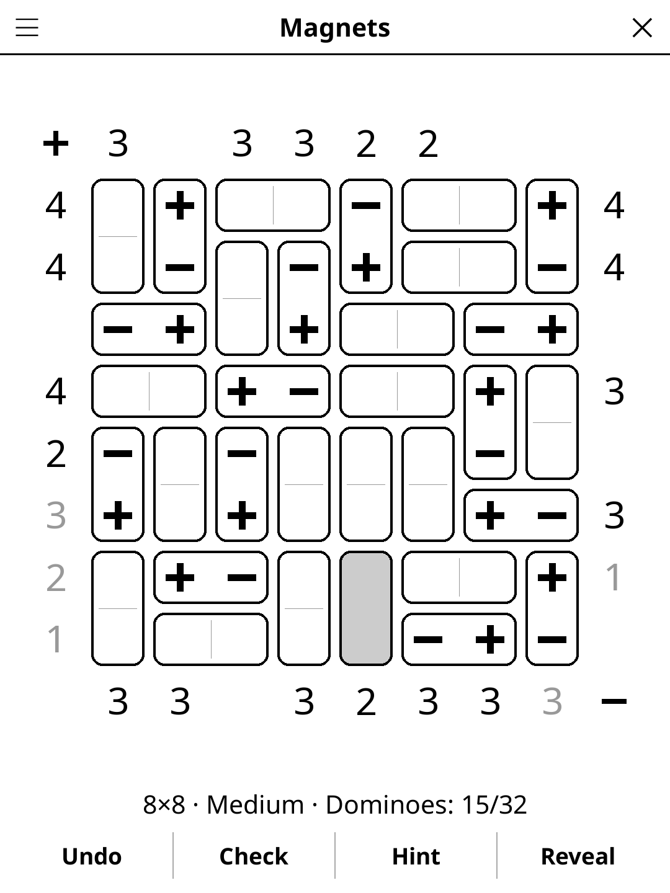

# magnets.koplugin

A Magnets logic puzzle (as in Simon Tatham's collection) for
[KOReader](https://github.com/koreader/koreader).

## Screenshot

## Rules

The grid is tiled with dominoes. Each domino is either a magnet — a + pole on
one half, a − pole on the other — or a blank piece with no poles.

1. Two identical poles may not touch side by side (horizontally or
   vertically). Diagonal contact is allowed.
2. The numbers on the top and left count the + poles in their column or row;
   the numbers on the bottom and right count the − poles. A blank clue gives
   no information.

## Features

- **Grid sizes** — 6×6, 8×8, 10×10
- **Three difficulty levels**, graded by the reasoning needed:
  - *Easy* — every clue shown; solvable from simple bounds on each line and
    "like poles can't touch".
  - *Medium* — a few clues hidden; needs exact counting of +, − and blanks
    along a line together.
  - *Hard* — many more clues hidden, still solved by line reasoning alone:
    no level ever needs "what if" trial and error.
- **Unique solution, proven** — the generator's solver deduces every domino
  before a puzzle is shown.
- **Live feedback** — clues grey out when met and turn white on black when
  exceeded; two like poles that touch are shown white in a black disc.
- **Blanks optional** — undecided dominoes count as blank for the win.
- **Hint** — two taps: the first says which cell is about to give, the second
  fills it (or clears a wrong domino).
- **Check**, **Reveal**, **Undo**, timer, and auto-save.

## Controls

| Action | How |
|--------|-----|
| Cycle a domino: +, −, blank, undecided | Tap either half (the tapped half gets the + first) |
| Mark / unmark a domino as blank | Long-press it |
| Undo / Check / Hint / Reveal | Buttons under the board |
| New game, size, difficulty, rules | Title-bar menu |

## Why e-ink friendly?

Poles are painted as thick bars, not font glyphs; blank dominoes are a flat
light grey; no animation, one board repaint per move.

## License

GPL-3.0
